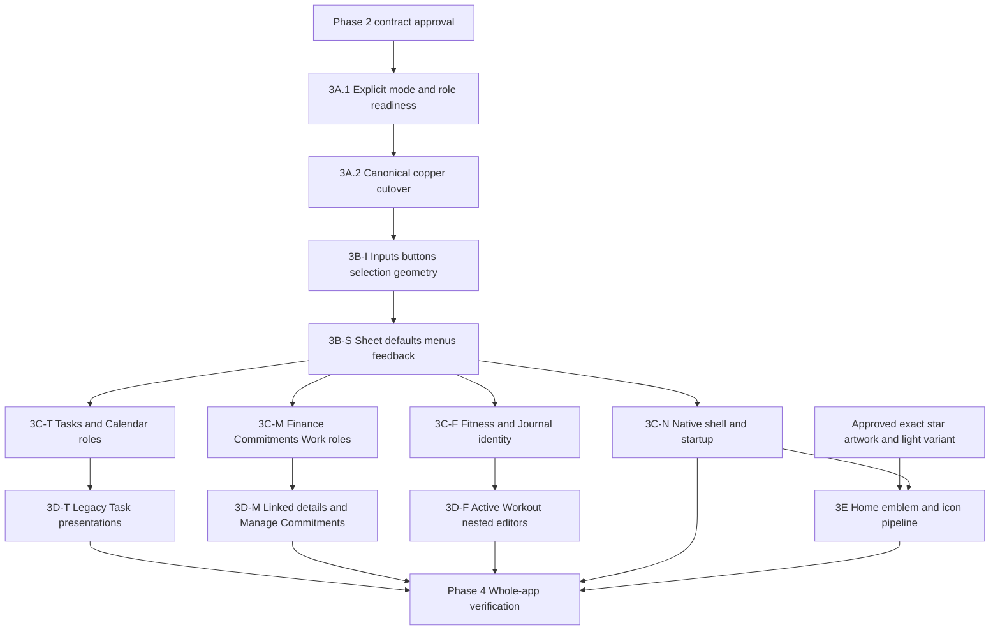

# Axis — controlled Soft Copper migration plan

Phase 2 planning only. [Specification](soft-copper-specification.md) · [Complete original-issue mapping](soft-copper-traceability.md) · [Machine mapping](soft-copper/traceability.json) · [Review](soft-copper/index.html).

The 20 original IDs, titles, evidence and priorities are preserved. No reprioritization:5 P1,12 P2,3 P3, no P0. This plan does not authorize runtime implementation. Phase 1's broad Phase3/4/5 roadmap is refined into the requested3A–3E implementation batches and Phase4 verification; VU-17's previous “Phase5” verification destination maps to Phase4 here, without changing its priority.

## Dependencies and order

Feature slices are independent after common contracts; the graph describes dependencies, not an instruction to run parallel agents. Collect native acceptance during each risky shared batch as well as final Phase4. If artwork is unavailable, all unrelated migration can proceed; **3E alone remains asset-gated**. No invented mark is an acceptable substitute.

## Prioritization by shared cause

| Group | Findings | Reason/order |
|---|---|---|
| Foundation blockers |VU-08 color meanings, VU-09 literal theme identity; VU-10 named type roles |Do before broad migration so a copper literal cannot select the wrong mode or acquire financial meaning |
| Shared component fixes |VU-04 fields, VU-05 defaults, VU-13 geometry, shared portion of VU-07; VU-18 conventions |Fix once with state/keyboard/focus checks; establish safe primitives before high-risk callers |
| Targeted legacy presentation |VU-01 Task Edit, VU-02 Workout nested forms, VU-03 linked details, VU-06 Manage, remaining VU-07 |Appearance opt-in is explicit; source behavior is preserved; do not flip every undefined appearance |
| Feature-owned exceptions |VU-11 identity, VU-12 native shell, VU-14 responsive investigation, VU-15 archive profiling, VU-16 launch/icon |Identity and OS ownership need distinct review; suspected native/performance issues require evidence, not speculative fixes |
| Final polish/context |VU-18 alignment, VU-19 contextual feedback consistency, VU-20 documentation; VU-17 gates every slice |Lower priority work stays traceable; consolidate only repeated same-intent patterns |

## Batch3A.1 — explicit mode and semantic readiness (first implementation prompt)

**Goal:** remove color-value-as-mode logic and prepare approved role consumption without visible recoloring.

Files:

- `src/constants/design-system-v2.ts`: explicit theme-mode type/resolver contract for `taskSectionSurface`; add missing semantic/feature role definitions or alias-ready types **without changing existing public-role values in this readiness batch**.
- `src/components/design-system.tsx`: expose resolved mode through the current color hook/selector; no extra ThemeProvider.
- `src/features/finance/overview-presentation.ts`: `overviewColors` takes explicit mode/resolved semantic palette rather than checking `canvas === '#151315'`.
- Actual consumers: `tasks/components/task-list-row.tsx`, `task-section.tsx`, `task-workspace-list.tsx`; Finance `cash-flow-chart.tsx`, `expense-donut-chart.tsx`, `transaction-row.tsx`, `finance-dashboard.tsx` as needed for the signature.
- Existing focused tests updated only where meaningful: `design-system-v2.test.ts`, `finance-overview-v2.test.ts`, `finance-charts.test.ts`, `calendar-components.test.ts`/Task presentation tests as applicable.

**Expected visual change:** none. Use a changed-canvas fixture to prove mode decisions do not depend on literal palette values. Preserve current default public colors until3A.2. Do not stage a second SoftCopper runtime palette/provider; readiness happens inside the existing design-system module and compatibility adapters.

Keep DesignPalette color-only: UiText accepts its keys as color names. Recommended helper in the existing module: `useDesignTheme(): { mode: DesignMode; colors: DesignPalette }`; keep `useDesignColors()` compatible by returning `.colors`. Pure helpers receive explicit mode (for example `overviewColors(colors, mode)` and `taskSectionSurface(colors, section, mode)`). Update the enumerated callers atomically and test both modes with arbitrary canvas values.

**Must not change:** screen layout, source/domain services, recurrence versions, financial arithmetic, dates/currency formatting, routes/native tab triggers/insets, shared controls' geometry/state, fonts, Home art/textures, modal behavior, app icon/config, dependencies, schema or persistence.

**Exit:** TypeScript and focused mode/chart/task regressions pass; ordinary current screenshots match both themes; no remaining HEX-equality mode decision in the two identified helpers. This is a small preparatory prompt, not a request to recolor the app.

## Batch3A.2 — canonical approved roles and copper cutover

**Goal:** apply the exact [token contract](soft-copper/token-register.md) within `design-system-v2.ts`, with explicit semantic aliases and named compact typography roles. This is the controlled global color checkpoint for already-v2 consumers.

**Files:** canonical token module, current color hook, narrowly scoped semantic adapters (`overview-presentation.ts` and status/feature adapters only as needed); `UiText` role selection for named types. Keep legacy `theme.ts` values as compatibility until explicit caller migration. No runtime import from docs JSON.

**Expected:** existing v2 shared rose selection/tints resolve copper; new role definitions are available. **Important coupling:** until3B's button resolver lands, current UiButton consumes brandStrong as default. Either land the primary default=brand binding atomically with this color cutover, or hold this branch from review/release until3B-I completes. Do not accept a transient implementation where pressed copper is mistaken for the approved primary. This atomic resolver-line exception is included in the scope.

**Tests:** canonical contrast pairs/states, explicit-mode independence, design-system/control tests. TypeScript, ESLint baseline comparison, chart/source regression subsets. **Captures:** all main v2 pages and representative nested sheets dark/light390; one control sheet at320/430/large text. NativeTabs tint smoke check; don't certify materials from HTML.

**Exit:** exact approved primary/pairings; documented alias provenance; no shared copper used as expense/overdue/completed; no new providers; Home images/textures byte-identical. This global token ripple is intentionally reviewed, not hidden in individual screen edits.

## Batch3B-I — inputs, buttons and selection

**Scope/files:** `design-system.tsx` UiButton/UiPressable, `control-appearance.ts`, `form-controls.tsx`, `autocomplete-field.tsx`, `internal-navigation.tsx`. VU-04/13 and component portion of08/10/18.

**Expected:** primary uses brand, pressed/hover brandStrong; neutral resting controlBorder; secondary/control, dangerSoft destructive; selected copper check/outline; distinct disabled/read-only;48 minimum hit regions with growth. Existingcompact Tasks internal navigation currently uses indigo selected text/underline; switch shared selection to copper while retaining indigo content identity.

**Unchanged:** refs, labels/value state, selection callbacks, validators/parsers, async busy guards, native single-line centering, source-provided accessibility hints, keyboard/focus portal owner. Controls with undefined appearance retain compatibility until migrated.

**Tests:** `form-controls`, `form-field-alignment`, `autocomplete`, `design-system`, `design-system-v2`, `context-menu` test files; selector state/error/disabled/read-only and target measurements. **Captures:** current/proposed normal/focus/invalid/selected/pressed/disabled in both themes;320/390/430 + doubled text proxy. **Native:** hardware/software keyboard, field focus, largest supported text; touch-region overlap.

**Risk/exit:** medium to high due broad callers; all meaningful boundaries>=3:1, text pairs>=4.5 where applicable, focus+error both present, targets>=48 without imposing fixed row heights. Decorative card dividers remain subtle.

## Batch3B-S — complete sheets, menus and feedback

**Scope/files:** `adaptive-sheet.tsx`, `back-button.tsx`, `form-selection-host.tsx`, `context-menu.tsx`, `sheet-refresh-notice.tsx`, `status-text.tsx`, `editor-section.tsx`; only view-layer wrappers/callers as needed. VU-05/shared07/13/19 and remaining10/18 mechanics.

**Expected:** default v2 sheet title/Back/Cancel/Save fully v2, radius20, default refresh message/Retry matches. SelectionOverlay's currently unconditional ThemedText heading becomes v2 when its appearance is v2. Menu uses surfaceRaised/controlBorder and actual48 target estimate. Keep custom editorial/operational title variants explicit.

**Unchanged:** AdaptiveModal route/presentation, sheet sizing/keyboard reveal/safe-area padding, selection host anchor/inline measurement, Android back/dismiss-before-action, first-action/return focus, user callbacks, retained snapshot/error content. No new snap points, drag interaction, nested modal routes or custom global nav.

**Tests:** `adaptive-sheet`, `context-menu`, `form-controls`, `refresh-lifecycle`, `navigation-conventions`. **Captures:** MonthChooser, Client History default header, custom Work/Commitment header, selector inline create, refresh failure, action menu; both themes and large text. **Native gate:** picker/header back, keyboard appearance, dismissal and correct final-row clearance.

**Exit:** no v2-only default ancestor leaves legacy typography/controls; legacy appearance still works; one refresh notice; measured header/content sizes correct. High risk: hold from merge/release until native focus/keyboard acceptance.

## Batch3C-T — Tasks and Calendar roles

**Files:** task v2 components/control wrappers, `tasks-screen.tsx` feedback only, Calendar `appearance.ts`, month-grid/day-agenda/shared-header callers. VU-11/07/14 portions.

**Expected:** shared selected/primary actions copper; indigo Task identity preserved; selected Calendar day copper; existing categorical Task/Commitment/Work dots unchanged. Complete fallback feedback presentation using existing state.

**Unchanged:** task order/sections/checkbox reopening/skipped, scheduled-date/historical recurrence semantics, Calendar dates/markers/source navigation. No domain edits. **Tests:** `task-workspace`, `task-section-navigation`, `task-history-v2`, `task-occurrence-presentation`, `calendar`, `calendar-markers`, `calendar-v2`, `calendar-components`, `calendar-experience`.

**Captures/exit:** main/Completed+Skipped/Repeating/month+agenda/empty, both themes, dates/long titles at320/390/430 and large text. Source markers and source-owned actions still correct; no extra tab bar or duplicated insets. This slice does not implicitly migrate legacy Task Editor, handled in3D-T.

## Batch3C-M — Finance, Commitments and Work identity

**Files:** Finance dashboard/chart/transaction/category visual adapters; Commitment v2 card/forms/details/histories; `work-main.tsx`, `work-client-details.tsx`, `work-job-details.tsx`, `work-clients.tsx`, Work history cards/feedback. VU-08/11/19 portions.

**Expected:** copper shared actions/filter/selection; financeIncome/financeExpense retain precise financial distinction; Work green identity consistent from main to details; received positive and outstanding neutral. Use existing compact financial arrangements and title roles.

**Unchanged:** financial arithmetic, payment date/category/allocation, actual-vs-expected, paid/skipped/unpaid, recurring schedule versions, linked deletion/undo, ordering and paged SectionList. **Work History is already v2; do not rebuild or tab-filter it.**

**Tests:** `finance-overview-v2`, `finance-charts-integration`, `finance-cash-flow-details`, `finance-spending-v21`, `transactions-v22`, `finance-categories-v2`, `commitments-experience`, existing commitment-v2 detail/history/payment/resume/editor tests, `work-experience`, `work-payment-v2`, `work-client-details-v2`, `work-job-details-v2`, `work-history-v2`.

**Captures/exit:** Overview/chart interval/donut, transaction with menu/link, categories active/archive, Commitment paid/skipped/overdue, Work main/job/client/global+client History; dark/light; long BRL figures at320/390/430/large text. No phantom “received” or expense/error confusion. High semantic risk even if color-only.

## Batch3C-F — Fitness and Journal identities

**Files:** Fitness v2 landing/content/library/history/rotation/editor identity mappings; Journal surface/date/editor/context/history visual mappings; no editor/service state machine change. VU-11/10/14 portions.

**Expected:** proposed emerald Fitness identity across destination tiles/progress if approved; copper shared actions/focus/selected controls. Journal retains quiet green reflection identity; shared Save/Back copper, writing surface neutral; Home Journal stays plum photograph.

**Tests:** `fitness-components`, `fitness-experience`, `workout-progress`, `fitness-manual-completion`, `fitness-history-v2`, `routines-v2`, `routine-editor-v2`, `routine-exercise-picker`, `workout-rotations-v2`, `journal-v2`, `journal-context`, `journal-drafts`, `journal-conflicts` and `journal-editor`.

**Captures/exit:** workout idle/active/completed, routines/new+edit+targets, rotations, library/archives, Journal draft/context/history/conflict; both themes and large text. All existing optional performance inputs, completion behavior and draft/conflict semantics retained. Legacy active-workout sheets migrate separately in3D-F.

## Batch3D-T — Task legacy presentations

**Files:** `task-editor.tsx`, `task-actions.tsx`, `occurrence-history.tsx`, `tasks-screen.tsx` explicit callers and existing control wrappers. VU-01 and legacy07.

**Expected:** ordinary Edit matches existing New Task v2 grammar; action sheet/per-task history follow shared v2 defaults/semantic archive styles. Keep existing completed/skipped global History layouts.

**Dependencies:**3B-S and3C-T. **Tests:** `tasks`, `tasks-experience`, `new-task-editor`, `task-occurrence-presentation`, `task-history-v2`, `repeating-tasks-v2`, `refresh-lifecycle`; true ordinary-edit branch plus recurring edit/picker return.

**Captures/exit:** New vs ordinary Edit vs schedule Edit, action sheet, per-task history empty/content, errors/dates/native picker; both themes. Draft persistence, recurrence version metadata and onCancel/onSave/skip/delete/reopen unchanged. High risk requires native keyboard/back/focus.

## Batch3D-M — linked payment and Manage Commitments

**Files:** `finance/components/transaction-detail.tsx`, Finance linked dialog appearance; `commitments/components/commitments-view.tsx` Manage-only rows/header/menu. VU-03/06.

**Expected:** neutral v2 linked details with copper Open source/Edit details; contained Manage series rows/status. **Dependencies:**3B-S,3C-M. **Tests:** transactions/finance/commitments source-link/deletion/undo tests, `transactions-v22`, `commitments-experience`, `work-experience`, `context-menu`.

**Captures/exit:** Work-linked and Commitment-linked detail, permitted action menu and errors, Manage active/paused/ended/completed and long names, both themes/narrow/large. No unrestricted manual transaction editor for a linked payment; no changed series action/state/order. High risk: linked ownership must survive styling.

## Batch3D-F — active-workout nested forms

**Files:** `fitness-forms.tsx` SetEditor/NoteEditor/AddExerciseSheet/ExerciseEditor inline, DurationFields/DistanceFields, autocomplete caller props and FitnessScreen if needed. VU-02.

**Expected:** v2 sheets, identity-tile treatment and copper shared actions/neutral field boundaries. **Dependencies:**3B-S,3C-F. **Tests:** `fitness`, `fitness-components`, `fitness-experience`, `fitness-set-completion`, `workout-flexible-completion`, `routine-exercise-picker`, `form-field-alignment`, `autocomplete`.

**Captures/exit:** strength/bodyweight/duration/distance, empty vs populated values, note, active Add Exercise search/create/select, errors/delete; both themes/narrow/large. Optional performance fields stay optional; add/select/create returns correct focus/screen; Routine picker stays a distinct v2 flow. High keyboard/source-state risk.

## Batch3C-N — native shell and startup presentation

**Files:** `src/app/_layout.tsx`, `src/components/app-tabs.tsx` token mapping only, `src/database/database-provider.tsx` presentation only; source-invalid fallback in `features/source-screen.tsx`; separate app.json splash colors only after native review. VU-12/16/07.

**Expected:** root backgrounds, tab tint and startup/failure UI agree with copper palette. **Dependencies:**3A/3B-S. **Unchanged:** five NativeTabs destinations/SF+Material icons, all route names/presentations, back behavior, startup database initialization, splash timing/retry, safe-area and native-tab ownership. No database recovery logic or predictive-back policy change in a color patch.

**Tests:** `navigation-conventions`, startup/error existing tests where present, TypeScript/full suite; native push/tab switch/first launch/retry/back and OS themes. **Captures/exit:** native iPhone and Android main tabs→pushed detail→sheet, launch/splash/loading/failure, last-row reachability. Native evidence is mandatory; cannot exit on browser mock tabs.

## Batch3E — brand symbol and app-icon pipeline (asset gated)

**Scope:** exact approved four-point-star source master and transparent dark/light Home exports; future Home header image only; platform app-icon outputs/config in a **separate sub-batch**. No generated/guessed geometry. **Dependencies:** approved artwork, approved light-ink variant, accepted3C-N.

**Home files later:** proposed `assets/images/brand/axis-emblem-{dark,light}.png`, source/provenance, `features/home/home-screen.tsx` header only. **Icon sub-batch:** `assets/expo.icon` iOS layered icon, Android adaptive foreground/background/monochrome, generic icon/favicon and app config. iOS icon currently overrides generic icon.png; handle both pipelines deliberately.

**Expected:** decorative48-unit top-right symbol, no button/square, no action. Dark cream star/copper ring; light same geometry with approved ink star. **Tests:** `home-background-v22`, Home disclosure/isolation/clearance tests found in repository, navigation conventions, asset hashes/dimensions/alpha integrity. **Captures:** Home dark/light320/390/430/OS large text collapsed/Today/Attention, launch icon under real platform masks.

**Exit:** exact geometry verified against selected source, transparency and edges clean, no accessibility/focus/touch target, no Expo Go gear recreated. Five photographs/two textures unchanged; title wins over decoration; expansion height/direct navigation/native tabs unchanged. If artwork missing, defer3E only and state that limit.

## Phase4 — whole-app verification and polish

VU-14/15/17 plus final18/19/20. Close every original finding with evidence or explicitly scoped deferral, never disappearance from the register.

- TypeScript, changed-file/full ESLint baseline, relevant feature regressions, full test suite, iOS and Android exports. Exports compile; they do not certify native UX.
- Fresh source atlas in both themes390, representative320/430 normal/large, with main/detail/editor/menu/empty/error/archive states. Preserve Phase1/2 evidence in place.
- Native iPhone/Android: OS themes, largest supported text, VoiceOver/TalkBack focus/state/error announcements, keyboard/IME, back/dismiss/return focus, native tabs/insets, source links/actual actions, Reduce Motion/Remove animations and scroll restoration.
- Home collapsed/Today/Attention/switch/collapse height and stable scroll, art contrast and final element above tabs. No negative-margin concealment, fixed disclosure reservation or extra safe-area padding.
- Profile large Journal/occurrence archives using recorded dataset/device/frame/memory; no automatic virtualization rewrite. Keep a separate optimization scope if results warrant it.
- Font fallback, alpha/low-contrast decorative boundaries, photo contrast and hardware performance. Copper should not replace semantic warning/success or categorical colors.
- Final docs align SDK58 and approved contracts through a scoped PRODUCT/DESIGN documentation update; preserve the original audit history. End with a bounded Impeccable polish/review pass, not an open-ended redesign.

## Acceptance record per batch

Record: exact base/head, changed files, mapped VU IDs, expected visual delta, unchanged source invariants, test commands/results, dark/light captures at named dimensions, native device/OS/font scale and unresolved limitations. A failed shared keyboard/focus/native gate blocks that batch's acceptance, not an excuse to modify domain semantics. No commit/push without a later explicit user instruction.
